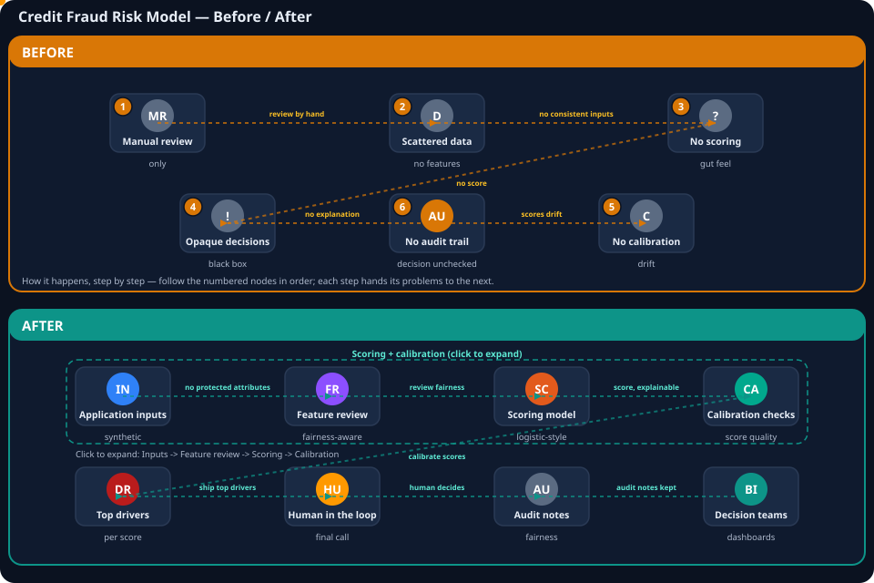

# Credit Fraud Risk Model

Portfolio implementation based on production work experience. All data is synthetic, all code is original and clean-room, and no proprietary code, data, schema names, or internal system details from any employer are included.

**Original context:** Fraud prediction models used to support whether a customer can be leased or financed, in a financial services setting. Qualitative production claim only, no real customer data, features, thresholds or model details from production are reproduced here.

**This portfolio version:** A fully synthetic dataset and an interpretable logistic-style scoring model in pure Python, with calibration checks, fairness-aware feature review notes, and a clear human-in-the-loop decision policy. The model supports a decision, it does not make a final eligibility decision on its own.

## Run
```bash
python -m src.generate_data
python -m src.train
python -m src.score --income 72000 --delinquencies 0 --utilisation 0.31
python -m pytest tests/ -q
```
## Guardrails
- No protected attributes are used as features
- Every score ships with its top drivers so a human reviewer can override
- Thresholds in this demo are illustrative only

## Architecture — Before / After

Hover any component to see what it is and why it is needed.


<details>
<summary><b>Scoring + calibration — click to expand the 4 steps</b></summary>

Collapsed, this is just: Application inputs -> Feature review -> Scoring model -> Calibration checks

1. Application inputs are taken for scoring, with no protected attributes used as features.
2. Features are reviewed for fairness before use, so the model stays explainable.
3. An interpretable scoring model produces each score, so it can be understood and audited.
4. Calibration checks run on scores, so the model stays honest over time.
</details>

### Earlier issues, risk, and impact after

| Aspect | Detail |
|---|---|
| Earlier issues | Every case reviewed by hand, so decisions were slow and inconsistent; application data scattered across sources, so no consistent inputs existed; no consistent score, so similar cases could get different outcomes; no explanation for a decision; no calibration checks; no audit trail. |
| Risk | Similar cases could get different outcomes; a decision that cannot be checked cannot be defended if challenged; scores could drift without anyone noticing. |
| Impact after | Every score is consistent and interpretable, shipped with its top drivers so a human reviewer sees why it scored that way; calibration checks keep scores honest over time; fairness and audit notes are kept with the model; a human reviewer still makes the final eligibility call. |

